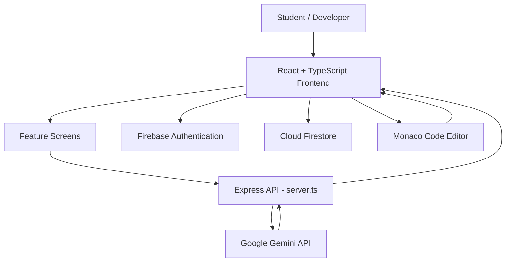

<div align="center">

# ✦ CodeBuddy AI ✦

### ⚡ Learn Smarter · Code Better · Build Your Future ⚡

**Your AI-powered companion for learning, writing, debugging, and mastering code.**

[](https://github.com/prathameshsutar140/Codebuddy-AI/stargazers)
[](https://github.com/prathameshsutar140/Codebuddy-AI/network/members)
[](https://github.com/prathameshsutar140/Codebuddy-AI/issues)
[](https://github.com/prathameshsutar140/Codebuddy-AI/commits/main)

<br />


</div>

---

> **「 Turn curiosity into code. Turn code into capability. 」**

CodeBuddy AI is an AI-powered programming learning platform built to help students and developers understand code, practice programming, debug errors, and improve their problem-solving skills in one place.

It brings together an AI coding assistant, code explanations, a debugging workspace, an interactive coding playground, quizzes, challenges, and learning analytics.

---

## ✨・FEATURES & CAPABILITIES

### 🤖 AI Code Assistant
- Chat with an AI assistant for programming help.
- Get explanations tailored to beginner, intermediate, or advanced levels.
- Ask for code generation, refactoring, algorithm conversions, and follow-up explanations.
- Copy generated code or download it as a file.

### 🔍 Code Explainer
- Explore code in C, C++, Python, Java, JavaScript, HTML/CSS, and SQL.
- Understand code through line-by-line explanations.
- Review variables, functions, and execution steps.
- Learn about time and space complexity with explanations.
- View sample inputs and outputs.

### 🐞 Debugging Lab
- Investigate syntax errors, runtime errors, and logic issues.
- Compare original code with suggested corrected code.
- Read explanations of the cause and suggested changes.
- Apply a suggested fix to the editor when ready.

### 💻 Interactive Coding Playground
- Write code in the Monaco Editor with syntax highlighting and line numbers.
- Work with JavaScript, Python, C, C++, Java, and SQL.
- Preview HTML and CSS in the browser.
- Review program output, errors, and execution time.
- Save useful snippets to your personal library.

### 📚 Programming Learning Center
Explore curated learning content for:
- C Programming
- C++ Programming
- Python
- Java
- JavaScript
- HTML and CSS
- SQL

### 🧠 AI Quiz Generator
- Generate programming multiple-choice quizzes.
- Practice with code-based questions and timers.
- Receive instant scores and explanations.
- Track quiz performance.

### 🏆 Practice Arena
- Practice problems involving arrays, strings, loops, algorithms, and data structures.
- Choose from Easy, Medium, and Hard difficulty levels.
- Use hints and check solutions against test cases.
- Track challenge progress.

### 🎓 Personal AI Tutor
- Get guided, step-by-step learning support.
- Use simple-English explanations and relatable analogies.
- Generate a personalized four-week study plan.
- Learn through hints and reasoning, not only final answers.

### 📁 Saved Code Library
- Keep code snippets organized with tags.
- Search, copy, and download saved snippets.
- Open a saved snippet directly in the playground.

### 📊 Learning Analytics
- Track learning hours, solved problems, and quiz accuracy.
- Review weekly and monthly activity charts.
- Explore programming-language distribution.
- Follow learning milestones and streaks.

### 🛡️ Administrator Dashboard
- Role-based access control for administrative features.
- View platform activity and operational metrics.
- Manage users and review curriculum status.


---

## 🎯・WHY WAS CODEBUDDY AI DEVELOPED?

Learning programming can be challenging when explanations, coding practice, debugging help, and progress tracking are spread across different tools. Beginners may also struggle to understand error messages or know what to practise next.

**CodeBuddy AI was developed to bring these learning activities together in one platform.** Its goal is to make programming more approachable, interactive, and practical for students and aspiring developers.

### The problems it aims to solve

- **Confusing code:** provide simple, structured explanations of programming concepts and code.
- **Debugging difficulties:** help learners understand likely errors and how to fix them.
- **Lack of guided practice:** offer quizzes, coding challenges, and learning content.
- **Scattered learning tools:** bring AI assistance, a coding workspace, saved snippets, and progress views into one application.
- **Unclear learning progress:** help users review their activity and identify areas to practise.

### Who can use it?

- Students learning programming fundamentals.
- Beginners practising their first programming languages.
- Developers who want a quick explanation or debugging perspective.
- Educators and mentors looking for a supplementary learning tool.

---

## ⚙️・HOW CODEBUDDY AI WORKS

CodeBuddy AI combines a React frontend, an Express backend, Google Gemini, and Firebase services.

1. **User interaction:** The user selects a feature from the navigation and enters a question, code sample, quiz topic, or learning request.
2. **Frontend:** React renders the relevant screen and manages the interface and user interaction.
3. **Backend request:** For supported AI features, the frontend sends a request to an Express API route.
4. **AI processing:** The backend uses the Google Gemini SDK and the configured API key to generate an explanation, debugging suggestions, quiz content, or tutor response.
5. **Response:** The backend returns the result to the frontend, where it is displayed for the user.
6. **Account and data services:** Firebase Authentication supports sign-in, while Firestore provides the database service used by the application.

### System architecture



**Important:** AI-generated explanations and suggested fixes are guidance. Review code and test it in an appropriate environment before relying on it.

---

## 🧭・HOW TO USE CODEBUDDY AI

1. Open the deployed CodeBuddy AI application, or run it locally using the setup instructions below.
2. Create an account or sign in if authentication is enabled for your deployment.
3. Use the sidebar to open the feature you need:
   - **AI Assistant:** ask programming questions and request code guidance.
   - **Code Explainer:** submit a code sample to receive a structured explanation.
   - **Debugging Lab:** share code and an error or unexpected result to get debugging suggestions.
   - **Playground:** write code in the editor and use the available run/preview options.
   - **Courses:** explore programming learning material.
   - **Quiz:** practise with generated programming questions.
   - **Challenges:** work through coding problems.
   - **AI Tutor:** ask for step-by-step learning support.
   - **Saved Codes:** organise and revisit useful snippets.
   - **Progress:** review available learning activity and progress information.
4. Read the explanations, try the suggested exercises, and verify code changes yourself.

Feature availability can depend on the application's configuration and connected services.

---

## 📥・CLONE & RUN LOCALLY

Want to explore the source code or contribute? Follow these steps to run your own local copy.

### 1. Check the requirements

Install:
- [Node.js](https://nodejs.org/) (LTS recommended)
- npm (included with Node.js)
- Git

You will also need a Google Gemini API key and a Firebase project for the services you want to use.

### 2. Clone this repository

Open a terminal and run:

```bash
git clone https://github.com/prathameshsutar140/Codebuddy-AI.git
cd Codebuddy-AI
```

### 3. Install project dependencies

```bash
npm install
```

### 4. Set up the Gemini API key

Create a `.env` file in the project root and add your own key:

```env
GEMINI_API_KEY=your_google_gemini_api_key
PORT=3000
NODE_ENV=development
```

Never publish your real API key or commit your private `.env` file.

### 5. Configure Firebase

The frontend initializes Firebase through `src/lib/firebase.ts` and the repository's `firebase-applet-config.json`. Configure the Firebase project, Authentication providers, Firestore database, and authorized domains for your own deployment. If you use environment-variable overrides, add the relevant `VITE_FIREBASE_*` settings to your local environment.

### 6. Start the development server

```bash
npm run dev
```

The Express server starts the Vite development middleware. Open the local address shown in the terminal (by default, `http://localhost:3000`).

### 7. Create a production build

```bash
npm run build
npm start
```

The production server serves the built frontend from the `dist` directory.

### Useful commands

| Command | Purpose |
| --- | --- |
| `npm run dev` | Start the local development server |
| `npm run build` | Create the production frontend build |
| `npm start` | Start the server in production mode |
| `npm run preview` | Preview the Vite build |
| `npm run lint` | Run the TypeScript check |

---

## 🎓・PROJECT OBJECTIVES

- Make programming concepts easier to understand through clear explanations.
- Encourage hands-on coding and regular problem-solving practice.
- Help learners interpret errors and improve their debugging skills.
- Offer learning activities for multiple programming languages.
- Bring useful learning tools together in one accessible interface.
- Encourage independent learning and continuous improvement.

---

## 🔮・FUTURE SCOPE

Possible future improvements include:

- More structured learning paths and beginner-friendly projects.
- Additional programming languages and practice challenges.
- Improved learning recommendations based on user activity.
- Expanded progress reports and achievement tracking.
- More robust automated code execution with a hardened, isolated runtime.
- Accessibility and multilingual learning improvements.

These are potential enhancements and should not be considered available features unless they are implemented in the application.

---

## 🧰・TECHNOLOGY STACK

| Area | Technologies |
| --- | --- |
| Frontend | React 19, TypeScript, Tailwind CSS, Vite |
| UI and charts | Lucide React, Recharts, Motion |
| Code editor | Monaco Editor |
| AI integration | Google Gemini API using `@google/genai` |
| Backend | Node.js, Express.js, TypeScript |
| Database | Firebase Firestore |
| Authentication | Firebase Authentication |
| Markdown | React Markdown, remark-gfm |

---

## 🗂️・PROJECT FILE STRUCTURE

The following tree reflects the repository's current top-level folders and the main files inside them.

```text
Codebuddy-AI/
│
├── api/
│   └── index.ts
│
├── src/
│   ├── components/
│   │   ├── AuthModal.tsx
│   │   ├── CodeBlock.tsx
│   │   ├── MarkdownRenderer.tsx
│   │   ├── Navbar.tsx
│   │   └── Sidebar.tsx
│   │
│   ├── context/
│   │   └── AuthContext.tsx
│   │
│   ├── data/
│   │   ├── challengesData.ts
│   │   └── coursesData.ts
│   │
│   ├── lib/
│   │   └── firebase.ts
│   │
│   ├── types/
│   │   └── index.ts
│   │
│   ├── views/
│   │   ├── AIAssistantView.tsx
│   │   ├── AdminView.tsx
│   │   ├── ChallengesView.tsx
│   │   ├── CodeExplainerView.tsx
│   │   ├── CoursesView.tsx
│   │   ├── DashboardView.tsx
│   │   ├── DebuggingLabView.tsx
│   │   ├── PlaygroundView.tsx
│   │   ├── ProgressView.tsx
│   │   ├── QuizView.tsx
│   │   ├── SavedCodesView.tsx
│   │   ├── SettingsView.tsx
│   │   └── TutorView.tsx
│   │
│   ├── App.tsx
│   ├── index.css
│   └── main.tsx
│
├── .env.example
├── .gitignore
├── bun.lock
├── firebase-applet-config.json
├── firebase-blueprint.json
├── firestore.rules
├── index.html
├── metadata.json
├── package.json
├── server.ts
├── tsconfig.json
├── vercel.json
└── vite.config.ts
```

### 📂 Folder guide

| Path | Purpose |
| --- | --- |
| `api/` | API entry point used by the deployment setup |
| `src/components/` | Reusable interface components |
| `src/context/` | Shared React context, including authentication state |
| `src/data/` | Course and coding-challenge data |
| `src/lib/` | Shared libraries and Firebase initialization |
| `src/types/` | TypeScript type definitions |
| `src/views/` | Main application screens and feature views |
| `server.ts` | Node.js / Express server entry point |
| `firestore.rules` | Firestore security rules |
| `vercel.json` | Vercel deployment configuration |

---

## 🚀・GETTING STARTED

### Prerequisites

- A recent Node.js LTS release
- npm
- A Google Gemini API key
- A Firebase project configured for the app's authentication and database features

### 1. Clone the repository

```bash
git clone https://github.com/prathameshsutar140/Codebuddy-AI.git
cd Codebuddy-AI
```

### 2. Install dependencies

```bash
npm install
```

### 3. Configure environment variables

Create a `.env` file in the project root:

```env
GEMINI_API_KEY=your_google_gemini_api_key
PORT=3000
NODE_ENV=development
```

Replace the placeholder with your own API key. Keep the `.env` file private and never commit real API keys or credentials.

### 4. Configure Firebase

Create or select a Firebase project and configure the Firebase Authentication and Firestore services used by the application.

For sign-in with a deployed Vercel URL, add that domain to Firebase Authentication's authorized domains. Also enable the sign-in providers used by your app.

### 5. Start the development server

```bash
npm run dev
```

Open the local URL printed in your terminal.

### Available scripts

| Command | Description |
| --- | --- |
| `npm run dev` | Start the development server |
| `npm run build` | Build the production frontend |
| `npm start` | Start the server in production mode |
| `npm run preview` | Preview the Vite production build |
| `npm run lint` | Run the TypeScript type check |

---

## ☁️・DEPLOYMENT ON VERCEL

1. Import this GitHub repository into your Vercel account.
2. Add the required environment variables in **Project Settings → Environment Variables**.
3. Add your Vercel deployment domain to **Firebase Console → Authentication → Settings → Authorized domains**.
4. Enable the authentication providers used by the application in Firebase Authentication.
5. Deploy the project and test sign-in, AI requests, and database-backed features.

**Environment variable:** Add `GEMINI_API_KEY` with your own Google Gemini API key. Add any other environment values required by your deployment configuration.

---

## 🔐・SECURITY NOTES

- Keep Gemini API keys and other secrets on the server; never expose them in frontend code.
- Do not commit `.env` files, private credentials, or service-account keys.
- Configure Firestore Security Rules so users can access only the data they are authorized to use.
- Keep code execution isolated and resource-limited. Do not treat a browser or server-side sandbox as a substitute for a hardened production execution environment.
- Review and test AI-generated code before using it in real projects.

---

## 🗺️・PROJECT VISION

CodeBuddy AI aims to make programming practice more approachable by combining explanations, hands-on coding, debugging, and guided learning in one platform.

Planned improvements may include more learning paths, additional programming exercises, and expanded progress insights.

---

## 🤝・CONTRIBUTING

Suggestions, bug reports, and improvements are welcome. You can help by opening an issue or submitting a pull request with a clear description of the change.

---

## 👨‍💻・DEVELOPER

**Prathamesh Sutar**

- GitHub: [@prathameshsutar140](https://github.com/prathameshsutar140)
- Repository: [CodeBuddy AI](https://github.com/prathameshsutar140/Codebuddy-AI)

---

<p align="center">
  ✦ ━━━━━━━━━━━━━━━━━━━━━━━━━━━━━━━━━━━━━━━ ✦
  <br />
  <strong>⚡ CODEBUDDY AI · LEARN · BUILD · LEVEL UP ⚡</strong>
  <br />
  <sub>Crafted with curiosity, creativity, and code by <a href="https://github.com/prathameshsutar140">Prathamesh Sutar</a>.</sub>
  <br />
  ✦ ━━━━━━━━━━━━━━━━━━━━━━━━━━━━━━━━━━━━━━━ ✦
</p>
